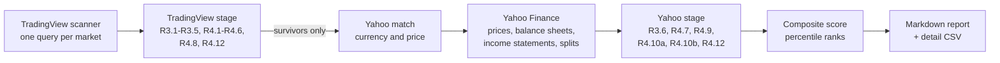

# portfolio-manager-agent

[](https://github.com/theo-s-bonnet/portfolio-manager-agent/actions/workflows/tests.yml)
[](LICENSE)


A rule-based stock screener for small and mid caps in North America and Europe, inspired by
the Higgons method: cheap (low P/E), profitable, growing companies with a sound balance sheet
and an upward price trend. One command downloads the universe, applies every written rule,
ranks the eligible stocks with a composite score and writes a Markdown report that explains
every exclusion.

This screener (V1) is the first building block of a personal investment agent. An LLM agent
that uses the screener as a tool is **planned** (see the [roadmap](#roadmap)); it is not part
of this release.

> **Not investment advice.** This is a personal research project. The output is a list of
> stocks that match a set of rules, computed from free, delayed and sometimes incomplete data.
> It is not a recommendation to buy or sell anything. Do your own research.

## How it works



The pipeline has two stages to keep Yahoo calls to a minimum. The TradingView scanner returns
the whole universe (about 16,000 stocks) with TTM ratios in one call per market; only the few
dozen stocks that survive this stage are downloaded one by one from Yahoo Finance for the
checks that need historical statements. Filters run from the cheapest to the most expensive.

## Screening rules

All thresholds live in [`config.yaml`](src/investment_agent/strategies/higgons/config.yaml);
the values below are the defaults. A stock is eligible only if **every** rule passes.

**Universe**

| Rule | Check |
|---|---|
| R3.1 | United States, Canada, EU, EEA, United Kingdom or Switzerland; primary listing; OTC excluded |
| R3.2 | Market cap between EUR 150M and EUR 10B |
| R3.3 | Average traded value of at least EUR 100k per day (approximation: 90-day average volume x last price) |
| R3.4 | Common stocks only: funds, ETFs, units (SPACs), REITs and depositary receipts excluded |
| R3.5 | Banks and insurers excluded (insurance brokers and investment banks are kept) |
| R3.6 | At least 6 months of prices and 3 annual balance sheets, including Y and Y-2 |

**Eligibility**

| Rule | Check |
|---|---|
| R4.1 | 0 < P/E TTM <= 12 |
| R4.2 | ROE TTM >= 10% |
| R4.3 | 5-year revenue CAGR >= 5% |
| R4.4 | Net debt / EBITDA TTM < 3, computed in code from net debt and EBITDA |
| R4.5 | Price > 102% of the 100-day EMA (the exit rule planned for later sits lower, to avoid round trips) |
| R4.6 | Raw 6-month performance >= 0% |
| R4.7 | Net cash in Y and Y-2, **or** net debt / equity down by at least 10 points between Y-2 and Y |
| R4.8 | TTM net income > 0 |
| R4.9 | Book value per share strictly up between Y-2 and Y (split-adjusted diluted shares) |
| R4.10a | Structural dilution: diluted share count up by at most 5% per year between Y-2 and Y |
| R4.10b | Recent dilution: current share count at most 5% above the count at the close of Y |
| R4.11 | Any missing data makes the stock ineligible; nothing is ever assumed to be zero |
| R4.12 | A ratio whose denominator is <= 0 makes the stock ineligible (EBITDA, EPS, equity in Y or Y-2) |

Y is the latest annual balance sheet; Y-2 is the one dated two years earlier (checked by its
date, so that a year missing at Yahoo does not shift it). Net debt is total debt minus cash
and cash equivalents; Yahoo's own "Net Debt" row is never used. Share buybacks are never
penalized.

**Composite score.** Each eligible stock gets a percentile rank (0 = worst, 100 = best) among
the eligible stocks on five components, then a weighted average:

| Component | Measure | Weight |
|---|---|---|
| Momentum | 6-month performance (higher is better) | 30% |
| Value | P/E TTM (lower is better) | 25% |
| Quality | ROE (higher is better) | 20% |
| Growth | 5-year revenue CAGR (higher is better) | 15% |
| Balance sheet | Net debt / EBITDA (lower is better) | 10% |

Ranking stocks against each other removes the need for a benchmark index per country. Ties
are broken by TradingView identifier, so the order is deterministic.

## Design principles

- **Deterministic.** Every number comes from code with fixed inputs; there is no model and no
  randomness in the pipeline. Network sources are injectable, so the whole run is tested
  without network access.
- **Thresholds only in the configuration.** Strategy code never contains a threshold: an AST
  test fails if `filters.py`, `fundamentals.py` or `scoring.py` contain any numeric constant
  other than 0, 1 and 100. Field names of the data source are also read from the configuration.
- **A status and a reason for every rule.** Each rule returns `pass`, `fail` or `missing`
  plus a reason (measured value and threshold, or the missing data). All rules of a stage are
  evaluated for every stock, so the detail CSV shows how far each stock is from each threshold.
- **Missing data is never replaced.** No zero, no back-fill, no silent fallback: the stock
  is excluded and listed separately in the report, so data problems stay visible.
- **Splits.** Share counts are made comparable across splits with a deterministic test that
  detects whether Yahoo has already adjusted the series; every split is reported.
- **Currencies.** TradingView is queried market by market, so amounts are in the market
  currency (`fundamental_currency_code`) while prices may be in a subunit (GBX in London).
  Market caps and liquidity are converted to euros with the right currency each. The global
  endpoint, which converts everything to USD at an unknown date, is never used.
- **Engine and strategy are separate.** The engine (data, report, orchestration) knows no
  rule; a strategy is a folder (configuration, filters, score) that does no network call.

## Example output

The report below is the reference used by the tests: three fictional stocks
([`tests/expected/report_min.md`](tests/expected/report_min.md), abridged).

```markdown
# Higgons screener: Saturday 2026-10-24

## Summary
| Step | Remaining | Excluded at this step | of which missing data |
|---|---|---|---|
| TradingView universe (2 markets) | 3 | — | — |
| R4.2 ROE | 2 | 1 | 1 |
| Yahoo match (currency and price) | 2 | 0 | 0 |
| R4.12 equity in Y and Y-2 | 2 | 0 | 0 |
| **Eligible** | **2** |  |  |

## Ranking
| # | Stock | Name | Country | Sector | Score | Perf 6M | P/E | ROE | Rev. CAGR 5y | ND/EBITDA |
|---|---|---|---|---|---|---|---|---|---|---|
| 1 | OSL:BBB (BBB.OL) | Bravo ASA | Norway | Transportation | 75.0 | +40.0% (100) | 9.0 (0) | 25.0% (100) | 12.0% (100) | −0.5 (100) |
| 2 | NYSE:AAA (AAA) | Alpha Inc | United States | Producer Manufacturing | 25.0 | +25.0% (0) | 6.0 (100) | 18.0% (0) | 8.0% (0) | 0.5 (0) |

## Excluded for missing or doubtful data
| Stock | Rules in `missing` | Missing or doubtful data |
|---|---|---|
| XETR:CCC (CCC.DE) | R4.2 | ROE missing (later steps not evaluated) |

## Warnings
### Splits detected (ratio, series adjusted by the script or not) (1)
- NYSE:AAA: split detected (ratio 2, adjusted: yes), between Y-2 and Y
```

The full report also lists data warnings (failed Yahoo matches, missing exchange rates,
exchanges without a Yahoo mapping, suspect share ratios) and the rules not implemented yet.

## Installation

Python 3.10 or later.

```powershell
# Windows (PowerShell)
git clone https://github.com/theo-s-bonnet/portfolio-manager-agent.git
cd portfolio-manager-agent
python -m venv .venv
.venv\Scripts\Activate.ps1
pip install -e ".[dev]"
```

```bash
# macOS / Linux
git clone https://github.com/theo-s-bonnet/portfolio-manager-agent.git
cd portfolio-manager-agent
python -m venv .venv
source .venv/bin/activate
pip install -e ".[dev]"
```

## Usage

```bash
python -m investment_agent run                            # full run (about 10 minutes)
python -m investment_agent run --markets america,uk       # partial run, for a quick test
python -m investment_agent run --output some/folder       # write the report elsewhere
```

Outputs go to `data/` (not tracked by Git):

- `data/reports/YYYY-MM-DD_higgons.md`: funnel by rule, ranking, exclusions for missing data,
  warnings, rules not applied;
- `data/reports/latest_run_detail.csv`: one row per stock of the universe with the raw data
  and the status and reason of every rule; standard CSV (comma, decimal point, UTF-8),
  overwritten on every run.

## Tests

```bash
pytest               # unit tests, no network (134 tests)
pytest -m network    # one real call per source (TradingView, Yahoo)
python scripts/check_tv_fields.py   # checks the TradingView field names against Yahoo (network)
```

CI runs the unit tests on Ubuntu with Python 3.10 and the latest stable Python.

## Repository structure

```
src/investment_agent/
├── __main__.py               command line: python -m investment_agent run
├── engine/                   no strategy rule in here
│   ├── config.py             loading and generic validation of a strategy configuration
│   ├── finance.py            safe ratios, split adjustment, percentile ranks
│   ├── statuses.py           pass / fail / missing, eligibility, first failed rule
│   ├── runner.py             orchestration of a run
│   ├── report.py             Markdown report and detail CSV
│   └── data/                 tradingview.py, yahoo.py (with cache), fx.py, tickers.py, yahoo_mapping.yaml
└── strategies/higgons/       one strategy = one folder, no network call
    ├── config.yaml           thresholds, weights, field names, data-quality parameters
    ├── filters.py            one pure function per rule
    ├── fundamentals.py       Y and Y-2 extraction from Yahoo statements
    └── scoring.py            composite score
scripts/check_tv_fields.py    one-off check of the TradingView fields
tests/                        unit tests, fake data (helpers.py), expected report
```

## Data sources and limitations

- **TradingView** data comes from the scanner endpoint used by tradingview.com, through the
  unofficial [`tradingview-screener`](https://pypi.org/project/tradingview-screener/) package.
  It is not an official API: fields can change without notice, and the data is delayed.
- **Yahoo Finance** data comes from [`yfinance`](https://pypi.org/project/yfinance/), also
  unofficial. Statements sometimes lack a row or a year; such stocks are excluded and listed.
- Both sources are meant for personal research; check their terms of use before any other use.
- Exchanges without a verified Yahoo mapping are excluded and counted in the report: NGM (the
  Yahoo listing has a different price), BER, BX, LJSE, ZSE, CSECY, BSESOF, BSSE, GETTEX, LS,
  LSX and TRADEGATE. The Yahoo suffix of every supported exchange was checked against a known
  ticker (same currency, same price), and each match is checked again at run time.
- Liquidity (R3.3) is approximated by the 90-day average volume times the last price.
- SPACs listed as common stock cannot be detected (only SPAC units can).
- The TradingView `country` field is the company's headquarters country, not the listing country.
- Fundamentals are the latest available values, not point-in-time data: the screener cannot be
  backtested as is.

## Roadmap

| Version | Content | Status |
|---|---|---|
| V1 | Screener: universe, eligibility filters, composite score, Markdown report | Done (this release) |
| V2 | First LLM agent: calls the screener as a tool and writes a standardized analysis sheet for the top candidates (red flags, dominant risk factor, sources); all calculations stay in the tools | Planned |
| V3 | Positions and exit rules (technical, valuation, eligibility, dilution), trade journal | Planned |
| V4 | Scheduled weekly run, report delivered without intervention | Planned |
| V5 | Portfolio construction: position size, sector and country limits, correlation groups | Planned |
| V6 | Earnings monitoring: facts extracted by the LLM, decision matrix applied in code | Planned |
| V7 | Weekly archive, shadow portfolios and backtests of rule variants | Planned |

The guiding principle for the agent: the LLM reads, summarizes, extracts facts and flags risks;
it never computes a ratio and never takes the decision.

## License

[MIT](LICENSE)
