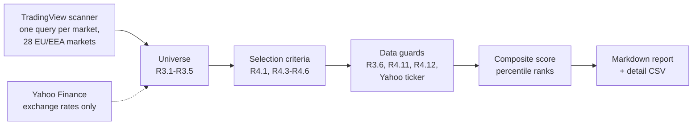

# portfolio-manager-agent

[](https://github.com/theo-s-bonnet/portfolio-manager-agent/actions/workflows/tests.yml)
[](LICENSE)


A rule-based stock screener for European small and mid caps, inspired by the Higgons method:
buy profitable, growing and cheap companies that the market is starting to re-rate. The
universe is limited to stocks that can be held in a French PEA (equity savings plan): EU and
EEA markets, headquarters in the EU or the EEA. One command downloads the universe, applies
every written rule, ranks the eligible stocks with a composite score and writes a Markdown
report that explains every exclusion.

This screener is the first building block of a personal investment agent. An LLM agent that
uses the screener as a tool is **planned** (see the [roadmap](#roadmap)); it is not part of
this release.

> **Not investment advice.** This is a personal research project. The output is a list of
> stocks that match a set of rules, computed from free, delayed and sometimes incomplete data.
> It is not a recommendation to buy or sell anything. Do your own research.

## How it works



The TradingView scanner returns the whole universe (about 5,000 stocks) with TTM ratios, the
EMA, the 6-month performance and the date of the first price, in one call per market. Every
rule is then evaluated for every stock, so the detail CSV shows how far each stock is from
each threshold. Yahoo Finance only supplies the exchange rates used to convert market caps and
traded values to euros.

## Screening rules

All thresholds live in [`config.yaml`](src/investment_agent/strategies/higgons/config.yaml);
the values below are the defaults. A stock is eligible only if it passes **every** rule of the
three groups. The rules are counted in this order in the report.

**Universe**

| Rule | Check |
|---|---|
| R3.1 | Listed on an EU or EEA market, headquarters country in the EU or the EEA, primary listing; OTC excluded |
| R3.2 | Market cap between EUR 150M and EUR 10B |
| R3.3 | Average traded value of at least EUR 100k per day (approximation: 90-day average volume x last price) |
| R3.4 | Common stocks only: funds, ETFs, units (SPACs), REITs and depositary receipts excluded; preferred shares excluded except in Germany (non-voting shares, often the only listed line) |
| R3.5 | Banks and insurers excluded (insurance brokers and investment banks are kept) |

**Selection criteria**

| Pillar | Rule | Check |
|---|---|---|
| Value | R4.1 | 0 < retained P/E <= 12 |
| Growth | R4.3 | 5-year revenue CAGR >= 5% |
| Balance sheet | R4.4 | Net debt / EBITDA TTM < 3, computed in code from net debt and EBITDA |
| Trend | R4.5 | Price > 102% of the 100-day EMA (the exit rule planned for later sits lower, to avoid round trips) |
| Trend | R4.6 | Raw 6-month performance >= 0% |

**Retained P/E.** The higher of the TradingView P/E TTM and market cap / TTM net income (both
in the reporting currency). The market cap uses the current share count, so a recent capital
increase is taken into account before it reaches the TTM EPS. If the TradingView P/E is
missing, market cap / TTM net income is used alone, and the fallback is flagged. An EPS, net
income or TradingView P/E <= 0 makes the P/E undefined: the stock fails R4.1.

**Data guards** (not strategy rules: they exclude stocks whose data is missing or inconsistent)

| Guard | Check |
|---|---|
| R3.6 | At least 6 months of prices, checked on the date of the symbol's first TradingView bar |
| R4.11 | Every measure of the score is available; nothing is ever assumed to be zero |
| R4.12 | A ratio whose denominator is <= 0 makes the stock ineligible (EBITDA, EPS) |
| Yahoo ticker | The exchange has a verified Yahoo Finance mapping (kept for the planned agent tools; nothing is downloaded) |

**Composite score.** Each eligible stock gets a percentile rank (0 = worst, 100 = best) among
the eligible stocks on five components, then a weighted average:

| Component | Measure | Weight |
|---|---|---|
| Momentum | 6-month performance (higher is better) | 30% |
| Value | Retained P/E (lower is better) | 25% |
| Quality | Retained ROE (higher is better) | 20% |
| Growth | 5-year revenue CAGR (higher is better) | 15% |
| Balance sheet | Net debt / EBITDA (lower is better) | 10% |

The retained ROE is the TradingView ROE TTM, even when it is negative (ranked last and
flagged). If it is missing, TTM net income / shareholders' equity of the last quarter is used
and flagged; with equity <= 0 the ratio is not computed and the stock is excluded by R4.11.
Ranking stocks against each other removes the need for a benchmark index per country. Ties
are broken by TradingView identifier, so the order is deterministic.

## Design principles

- **Deterministic.** Every number comes from code with fixed inputs; there is no model and no
  randomness in the pipeline. Network sources are injectable, so the whole run is tested
  without network access.
- **Thresholds only in the configuration.** Strategy code never contains a threshold: an AST
  test fails if `filters.py` or `scoring.py` contain any numeric constant other than 0, 1 and
  100. Field names of the data source are also read from the configuration.
- **A status and a reason for every rule.** Each rule returns `pass`, `fail` or `missing`
  plus a reason (measured value and threshold, or the missing data). Every rule is evaluated
  for every stock.
- **Strategy rules and data guards are separate.** The funnel shows the universe, the
  selection criteria and the data guards as three groups, so that the stocks lost because of
  the data stay visible.
- **Missing data is never replaced.** No zero, no back-fill, no silent fallback: the two
  explicit fallbacks (retained P/E, retained ROE) are flagged in the ranking, counted under
  the funnel and listed in the warnings.
- **Currencies.** TradingView is queried market by market, so amounts are in the market
  currency (`fundamental_currency_code`). Market caps and liquidity are converted to euros
  with the right currency each. The global endpoint, which converts everything to USD at an
  unknown date, is never used.
- **Engine and strategy are separate.** The engine (data, report, orchestration) knows no
  rule; a strategy is a folder (configuration, rules, score, funnel) that does no network call.

## Example output

The report below is the reference used by the tests: three fictional stocks
([`tests/expected/report_min.md`](tests/expected/report_min.md), abridged).

```markdown
# Higgons screener: Saturday 2026-10-24

## Summary
| Step | Remaining | Excluded at this step | of which missing data |
|---|---|---|---|
| TradingView universe (2 markets) | 3 | — | — |
| **Universe** |  |  |  |
| R3.1 PEA universe: market, headquarters, primary listing | 3 | 0 | 0 |
| **Selection criteria** |  |  |  |
| R4.1 retained P/E | 3 | 0 | 0 |
| **Data guards** |  |  |  |
| R4.11 data needed by the score | 2 | 1 | 1 |
| Yahoo ticker available | 2 | 0 | 0 |
| **Eligible** | **2** |  |  |

## Ranking
| # | Stock | Name | Country | Sector | Score | Perf 6M | P/E | ROE | Rev. CAGR 5y | ND/EBITDA |
|---|---|---|---|---|---|---|---|---|---|---|
| 1 | OSL:BBB (BBB.OL) | Bravo ASA | Norway | Transportation | 75.0 | +40.0% (100) | 8.3† (0) | 25.0% (100) | 12.0% (100) | −0.5 (100) |
| 2 | EURONEXT:AAA (AAA.PA) | Alpha SA | France | Producer Manufacturing | 25.0 | +25.0% (0) | 6.0 (100) | 18.2%‡ (0) | 8.0% (0) | 0.5 (0) |

† fallback: market cap / TTM net income (TradingView P/E missing)
‡ fallback: TTM net income / shareholders' equity of the last quarter (TradingView ROE missing)

## Excluded for missing or doubtful data
| Stock | Rules in `missing` | Missing or doubtful data |
|---|---|---|
| XETR:CCC (CCC.DE) | R4.11 | ROE missing; fallback not computed: shareholders' equity -100,000,000 ≤ 0 |

## Warnings
### Statutory country (ISIN prefix) outside the EU/EEA: check PEA eligibility (1)
- EURONEXT:AAA: ISIN BMG000TEST01, headquarters France
```

The full report also lists the other warnings (TradingView markets in error, missing exchange
rates, exchanges without a Yahoo mapping, fallbacks, ROE <= 0), the eligible stocks by
country and the rules not implemented yet.

## Installation

Python 3.10 or later.

```powershell
# Windows (PowerShell)
git clone https://github.com/theo-s-bonnet/portfolio-manager-agent.git
cd portfolio-manager-agent
python -m venv .venv
.venv\Scripts\Activate.ps1
pip install -e ".[dev]"
```

```bash
# macOS / Linux
git clone https://github.com/theo-s-bonnet/portfolio-manager-agent.git
cd portfolio-manager-agent
python -m venv .venv
source .venv/bin/activate
pip install -e ".[dev]"
```

## Usage

```bash
python -m investment_agent run                             # full run (about a minute)
python -m investment_agent run --markets france,germany    # partial run, for a quick test
python -m investment_agent run --output some/folder        # write the report elsewhere
```

Outputs go to `data/` (not tracked by Git):

- `data/reports/YYYY-MM-DD_higgons.md`: funnel by group and rule, ranking, exclusions for
  missing data, warnings, rules not applied;
- `data/reports/latest_run_detail.csv`: one row per stock of the universe with the raw data,
  the derived values (retained P/E and ROE with their source, first bar date...) and the
  status and reason of every rule; standard CSV (comma, decimal point, UTF-8), overwritten on
  every run.

## Tests

```bash
pytest               # unit tests, no network (171 tests)
pytest -m network    # one real call per source (TradingView, Yahoo)
python scripts/check_tv_fields.py   # checks the TradingView fields on the EU/EEA markets (network)
```

CI runs the unit tests on Ubuntu with Python 3.10 and the latest stable Python.

## Repository structure

```
src/investment_agent/
├── __main__.py               command line: python -m investment_agent run
├── engine/                   no strategy rule in here
│   ├── config.py             loading and generic validation of a strategy configuration
│   ├── finance.py            safe ratios, split adjustment, percentile ranks
│   ├── statuses.py           pass / fail / missing, eligibility, first failed rule
│   ├── runner.py             orchestration of a run, Yahoo ticker guard
│   ├── report.py             Markdown report and detail CSV
│   └── data/                 tradingview.py, fx.py, tickers.py, yahoo_mapping.yaml,
│                             yahoo.py (prices and statements, kept for the planned agent tools)
└── strategies/higgons/       one strategy = one folder, no network call
    ├── config.yaml           thresholds, weights, field names, data-quality parameters, rule register
    ├── filters.py            one pure function per rule, retained P/E and ROE, warnings
    └── scoring.py            composite score
scripts/check_tv_fields.py    one-off check of the TradingView fields
tests/                        unit tests, fake data (helpers.py), expected report
```

## Data sources and limitations

- **TradingView** data comes from the scanner endpoint used by tradingview.com, through the
  unofficial [`tradingview-screener`](https://pypi.org/project/tradingview-screener/) package.
  It is not an official API: fields can change without notice, and the data is delayed.
- **Yahoo Finance** exchange rates come from [`yfinance`](https://pypi.org/project/yfinance/),
  also unofficial.
- Both sources are meant for personal research; check their terms of use before any other use.
- The TradingView `country` field is the declared headquarters, often the operational seat,
  not always the country of incorporation that decides PEA eligibility (a company incorporated
  in Bermuda can have its head office in Norway). The report warns when the ISIN prefix is
  outside the EU/EEA; final eligibility has to be confirmed with the broker.
- A ticker change resets the date of the first TradingView bar: the stock is then excluded by
  R3.6 for six months, consistently with its 6-month performance and EMA, which TradingView
  computes on the short history.
- TradingView provides no 3-year revenue CAGR: growth is measured over 5 years.
- Exchanges without a verified Yahoo mapping are excluded and counted in the report: NGM (the
  Yahoo listing has a different price), BER, LJSE, ZSE, CSECY, BSESOF, BSSE, GETTEX, LS, LSX
  and TRADEGATE.
- Liquidity (R3.3) is approximated by the 90-day average volume times the last price.
- SPACs listed as common stock cannot be detected (only SPAC units can).
- Fundamentals are the latest available values, not point-in-time data: the screener cannot be
  backtested as is.

## Roadmap

| Version | Content | Status |
|---|---|---|
| V1 | Screener: universe, eligibility filters, composite score, Markdown report | Done |
| V1.1 | Strategy 2.0: PEA universe, retained P/E and ROE, criteria and data guards reported separately, single TradingView stage | Done (this release) |
| V2 | First LLM agent: calls the screener as a tool and writes a standardized analysis sheet for the top candidates (red flags, dominant risk factor, debt trajectory, sources); all calculations stay in the tools | Planned |
| V3 | Positions and exit rules (technical, valuation, eligibility, dilution), trade journal | Planned |
| V4 | Scheduled weekly run, report delivered without intervention | Planned |
| V5 | Portfolio construction: position size, sector and country limits, correlation groups | Planned |
| V6 | Earnings monitoring: facts extracted by the LLM, decision matrix applied in code | Planned |
| V7 | Weekly archive, shadow portfolios and backtests of rule variants | Planned |

The guiding principle for the agent: the LLM reads, summarizes, extracts facts and flags risks;
it never computes a ratio and never takes the decision.

## License

[MIT](LICENSE)
